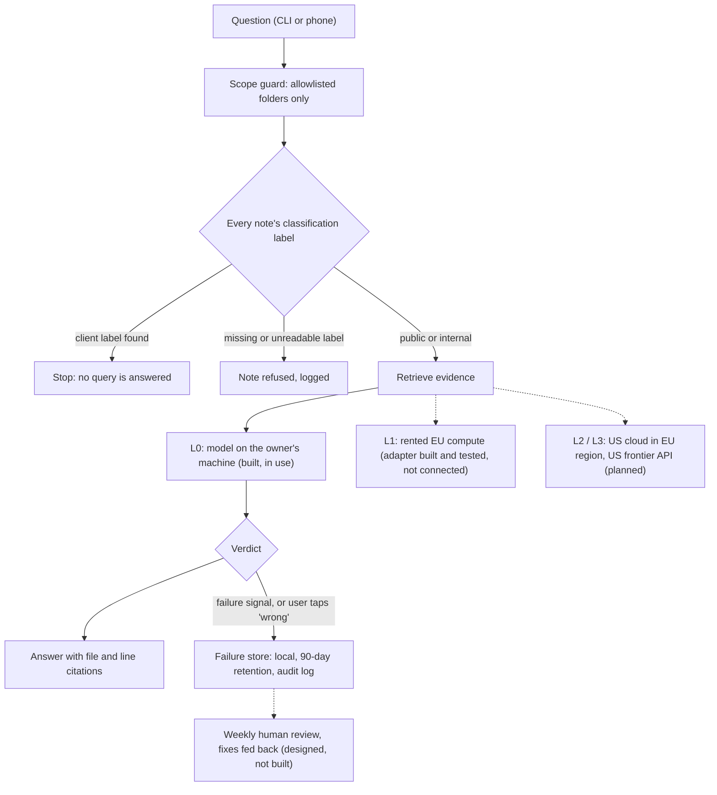

# governed-ai-runtime

A reference implementation of a governed AI assistant over a personal knowledge base.
It answers questions from markdown notes with citations, enforces data classification in
code, and keeps failed answers for human review. It was built by one person, directing
Claude Code and Codex agents under a written change-control protocol, as a working model
of how AI can be run in a regulated organisation.

This repository is a public copy of a private system. The code and tests are the real
ones; the notes it reads here are synthetic.

## The problem it addresses

A bank, an asset manager or a hospital that wants to use AI on internal documents faces
the same three questions:

1. **Which data may reach which model?** Client material, health data and ordinary
   internal notes need different handling, and the rule has to hold even when someone
   misconfigures a path or a provider.
2. **Can we trust the answer?** An answer needs to show its sources, and the system needs
   to say "I don't know" rather than invent.
3. **How does quality improve without exposing data?** Failures have to be studied, but
   the people and tools studying them should not see more data than they need.

This system answers those questions at the scale of one person's notes, with the controls
written as code and covered by tests rather than stated in a policy document.

## How it works



Solid lines are built and tested. Dotted lines are designed but not yet built.

1. **Scope.** The service can only open files on an allowlist. It refuses `..`, symlinks
   and hard links anywhere on the path, and opens each folder through the previous one so
   a path cannot be swapped between the check and the read.
2. **Classification.** Every note must carry `classification: public | internal | client`.
   A missing or ambiguous label is a refusal: absence of a label is not permission. A note
   labelled `client` stops every query until it is removed, because client material should
   not be in the knowledge base at all.
3. **Answer.** A local model answers only from the retrieved evidence and must cite it.
   Each answer gets one of three verdicts: `supported`, `incomplete` (no citation, invented
   source, or wording that does not match the evidence) or `withheld` (nothing found, or the
   model declined).
4. **No silent cloud fallback.** The local adapter refuses any non-local address, any
   redirect and any proxy setting. If the model is down, the answer says so; nothing is
   sent elsewhere.
5. **Failure capture.** A failed answer, or one the user marks wrong with one tap on the
   phone, is stored locally outside the knowledge base for 90 days. A separate audit log
   records every step without the question or answer text.
6. **Writes.** The service writes to the knowledge base in one way only: a new note in the
   inbox, never an edit. Traces and logs go outside it, and the question is stored as a hash.

## Design decisions and trade-offs

| Decision | Chosen | Given up |
|---|---|---|
| Privacy versus quality | Local model first; data leaves the machine only at a level its classification allows | Answer quality and speed of a frontier model |
| Refusal versus coverage | Unlabelled or ambiguous notes are refused | Some legitimate notes are skipped until relabelled |
| Plain search versus vector store | Keyword retrieval over files, no vector database | Weaker recall on paraphrased questions |
| No fallback | A provider that fails returns an error | Availability: no automatic retry on another model |
| Independent review | Every change is reviewed by a model from a different vendor (Codex) before commit | Slower delivery; review rounds cost time |
| Cost | Rent compute rather than buy hardware; step up to a stronger model only when needed (designed) | Rented compute is a third party, so it sits at a stricter-than-local level |

The full sovereignty model is in [docs/SOVEREIGNTY-MODEL.md](docs/SOVEREIGNTY-MODEL.md).
How the agents that built this were governed is in [docs/GOVERNANCE.md](docs/GOVERNANCE.md).

## How quality is measured

- **Tests.** 706 automated tests. Each safety claim (scope, read-only, no cloud fallback,
  no question text in traces) has a test that fails if the claim stops being true, many of
  them attempting the actual attack (symlink swap, redirect to an outside address, hard
  link into the knowledge base).
- **Development cases.** Ten fixed questions with expected evidence, including two that
  the knowledge base cannot answer. The `examples/dev-cases.json` set here runs against the
  synthetic notes.
- **Regression and injection sets.** Synthetic question sets for date handling and for
  prompt injection hidden inside notes (`experiments/`).
- **Model selection by measurement.** Candidate local models were compared on the same
  frozen evidence, scored by two judges, before the default was changed.

Measured on the owner's private notes (October 2026, Apple laptop, local model only):

| Model | Correct, of 8 answerable cases | Declined both unanswerable | p50 | p95 |
|---|---|---|---|---|
| Gemma 4 26B-A4B (current default) | 7 | yes | 8.5 s | 13.8 s |
| Gemma 4 E4B (previous default) | 5 | yes | 8.3 s | 10.5 s |

The target was under 8 seconds at p95. It is not met; the owner accepted the slower,
more accurate model for local use. The raw measurement records are not published because
they reference private notes.

## Status and limitations

Built and tested:
- scope, classification and read-only guards
- local-only model adapter with no fallback
- answer verdicts with citations
- failure capture with one-tap "wrong", leak check, 90-day retention and audit log
- an adapter for one rented EU provider (Scaleway, level L1), chosen only by explicit
  configuration, with its key read from the operating system's keychain
- a phone front end over a private network (Apple Shortcuts, `mvp/`)

Not built yet:
- the router that picks a level per request from data classification (L1 is not
  connected to any entry point; L2 and L3 do not exist)
- cost-aware model choice that steps up to a stronger model on an incomplete answer
- the weekly triage of captured failures and the loop that feeds fixes back
- an entailment check: today no answer is reported as `supported`; a grounded answer comes
  back `incomplete` with the reason "entailment unverified"

Known weaknesses, stated in [docs/STATUS.md](docs/STATUS.md): grounding is a word-overlap
check, not a faithfulness check; decline detection is a phrase list; abstention depends on
the model.

## What is deliberately not in this repository

- The owner's notes, measurement records, traces and failure store. The original frozen
  evaluation corpus was replaced by the synthetic `examples/sample-vault/`.
- Personal data of any kind, and any client or employer material.
- Model weights (listed with hashes in `models/MANIFEST.md`) and access tokens.

## How to run it

macOS or Linux, Python 3 standard library only (PyYAML is used if present, as a second
parser check). The suite was last run with Python 3.13 on Linux.

```sh
python3 -m unittest discover -s tests -t .   # full suite
./run_dev_cases.py --stub-model              # the 10 dev cases, retrieval only
./query "What counts as a tempo session?" --stub-model
./secret_scan.sh                             # credential scan of this repository
```

`--stub-model` runs the pipeline without a model. To get real answers, start a local
[llama.cpp](https://github.com/ggml-org/llama.cpp) server on `127.0.0.1:18087` with one of
the models in `models/MANIFEST.md`, and drop the flag. Set `DBRAIN_VAULT` to use your own
notes and `DBRAIN_LOGS` to choose where logs go. The phone set-up in `mvp/` assumes macOS.

One test checks a macOS-only file-name behaviour and is skipped on other systems.
